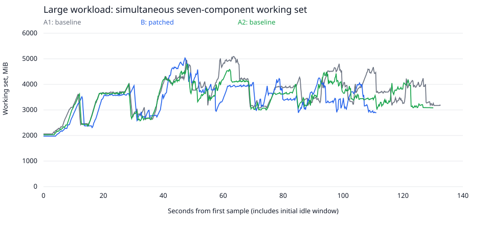

# API / Task SDK configuration memory: local review evidence

Baseline: `750f849cc2372ee42dc6910541d4b6a866102ac9`.
Candidate: baseline plus [source.diff](source.diff), SHA256 `1b953037b828adcd32fef174c2e3da3d1f45910488c5e9c25f8b79bb2b4f65c4`.

**No PR, push, ADME deployment or scheduler optimization was performed.**

## Executed tests

- 736 focused/adjacent regression cases passed across SDK, SQLite, PostgreSQL and MySQL.
- Official SDK and supervisor schema generation passed; targeted mypy and Ruff checks passed.
- 111 real local DagRuns verified across baseline, patched and rollback arms.
- 3 intentionally negative runs ended failed as expected; they are not hidden successes.
- Performance runs succeeded on the first attempt.
- Retry, deferral/resume, empty configuration and false-valued parameters were exercised separately.
- Functional run success does not mean every HTTP attempt succeeded; the recovered errors are listed below.

## Main interpretation

**This experiment did not demonstrate a full-stack peak-memory reduction.**
The candidate peak was 5031.3 MiB, versus baseline peaks of 5091.7 and 4795.5 MiB.
It was 1.8% above the two-baseline mean and inside the baseline range (spread 6.0%).
Do not replace this finding with the much larger isolated-phase allocation reductions.

Large-workload completion time was 105.2s in the candidate versus 126.6s and 124.3s in the baselines (16.1% lower than their mean).
Component-specific results below must not be presented as the full-stack total.

## Time-aligned application working-set peaks

All values are MiB. These peaks are measured totals of seven component working sets at each sample,
**not sums of independent component peaks**. See [the protocol](TEST-PROTOCOL.md) for the accounting.

| Payload | A1 baseline | B patched | A2 baseline | B reduction vs baseline mean | Baseline spread |
| --- | ---: | ---: | ---: | ---: | ---: |
| small | 2353.7 | 2334.1 | 2333.1 | 0.4% | 0.9% |
| medium | 2928.8 | 2944.8 | 2938.0 | -0.4% | 0.3% |
| large | 5091.7 | 5031.3 | 4795.5 | -1.8% | 6.0% |

## Workload completion time

Seconds from unpausing admitted runs to all declared terminal states. Admission and result
verification are recorded separately and excluded from this interval.

| Payload | A1 baseline | B patched | A2 baseline | B reduction vs baseline mean |
| --- | ---: | ---: | ---: | ---: |
| small | 13.8 | 12.7 | 13.8 | 7.6% |
| medium | 23.8 | 20.3 | 20.2 | 7.6% |
| large | 126.6 | 105.2 | 124.3 | 16.1% |

## Large-payload composition at the actual group-peak sample

| Component | A1 | B | A2 |
| --- | ---: | ---: | ---: |
| api | 676.0 | 549.1 | 574.4 |
| scheduler | 1869.9 | 1863.2 | 1878.7 |
| worker | 1474.5 | 1453.0 | 1465.0 |
| dag-processor | 223.5 | 222.7 | 222.5 |
| triggerer | 450.2 | 450.0 | 449.5 |
| postgres | 392.1 | 488.7 | 200.1 |
| redis | 5.5 | 4.7 | 5.3 |

## Individual component peaks, not an application total

Each component's peak can occur at a different time. This table is diagnostic only.

| Component | Baseline mean own peak, MiB | Patched own peak, MiB | Reduction |
| --- | ---: | ---: | ---: |
| api | 915.2 | 694.4 | 24.1% |
| scheduler | 2247.1 | 2248.7 | -0.1% |
| worker | 1610.9 | 1453.2 | 9.8% |
| dag-processor | 250.9 | 250.6 | 0.1% |
| triggerer | 451.8 | 450.7 | 0.2% |
| postgres | 513.8 | 695.7 | -35.4% |
| redis | 7.5 | 6.9 | 7.4% |

## Execution API access-log duration across the full workload mix

Server-side request durations are not client end-to-end startup latency.

| Arm | Task-start requests | HTTP statuses | P50, ms | P95, ms |
| --- | ---: | --- | ---: | ---: |
| a1 | 60 | {'400': 16, '200': 44} | 1434.2 | 6323.8 |
| b | 56 | {'400': 16, '200': 40} | 518.3 | 6392.1 |
| a2 | 60 | {'400': 16, '200': 44} | 1305.3 | 6263.8 |

**Qualification:** 16 HTTP 400 task-start responses occurred in each arm, followed by successful
recovery without unexpected performance-task retries. They cluster in the first worker batch after
the intentional API restarts. Cold Execution API initialization versus the default five-second SDK
timeout is a hypothesis consistent with the timing, not a conclusively reproduced root cause.
The raw request and worker retry logs are retained. Resolve or isolate this effect before claiming
error-free startup behavior or a clean steady-state request-latency improvement.

## Successful task-start responses only

| Arm | P50, ms | P95, ms |
| --- | ---: | ---: |
| a1 | 3482.2 | 4878.5 |
| b | 1124.6 | 1990.6 |
| a2 | 1595.8 | 5034.9 |

## Separate unchanged-baseline startup control

This is not another memory-patch result and does not replace the original A/B/A observations.

| Readiness before execution | Verified DagRuns | Task-start HTTP statuses | Completion, s |
| --- | ---: | --- | ---: |
| diagcold | 4 | {'400': 4, '200': 4} | 13.8 |
| diagwarm | 4 | {'200': 4} | 9.6 |

Warming `/execution/health` on the same unpatched baseline removed the observed HTTP 400s
in this small control (4 HTTP 400s cold, zero warm). This supports a readiness/cold-start
explanation rather than a new memory-patch regression. The precise transport failure
mechanism is not established, and the full large A/B/A was not rerun with this warm-up.

[Raw startup-control results](startup-diagnostic/results.json).
An earlier OpenAPI warm-up attempt failed on the unchanged baseline with a response-length
error; its logs and four completed cold-control runs are retained in
`startup-diagnostic/attempt-openapi/`, outside the completed comparison counts.

## Regressions, trade-offs and limits

- The asset-event collection read adds one database round trip to avoid repeating the large JSON text.
- Native JSON type checking adds database work but rejects invalid roots before RUNNING is committed.
- The prior isolated task-phase benchmark retained a small allocation increase; it is not concealed.
- Two baseline observations and one candidate observation are not a statistical guarantee.
- Report small-input overhead and baseline variability along with large-input improvements.
- Local cgroup working sets are not production pod RSS, PSS or whole-host usage.
- The worker executes up to four tasks concurrently; the large scenario admits 20 DagRuns.
- The API is intentionally restarted after admission in every scenario to isolate the changed execution path.
- This synthetic workload has no external OSDU services or ingestion/search correctness claim.
- A pre-workload read-only-UI-directory harness failure is preserved in `setup-attempts/`.
- A second UI directory was provisioned during baseline setup; all measured windows used fresh API processes.
- Mixed unreleased core/SDK builds, AKS/Helm rollout and production behavior remain outside this evidence.

## Review and reproduction

- [Protocol, configurations and reproduction steps](TEST-PROTOCOL.md)
- [Exact source patch](source.diff)
- [Pinned source/image/resource manifest](source-manifest.json)
- [Machine-readable comparison](comparison.json)
- [Complete verified runs, timings and per-scenario summaries](e2e-results.json)
- Per-arm directories preserve raw memory samples, status samples and service logs.
- [Prior regression-test reports](local-regression-results/validation-summary.json)

The source remains local and uncommitted. This document is evidence for review, not production approval.
